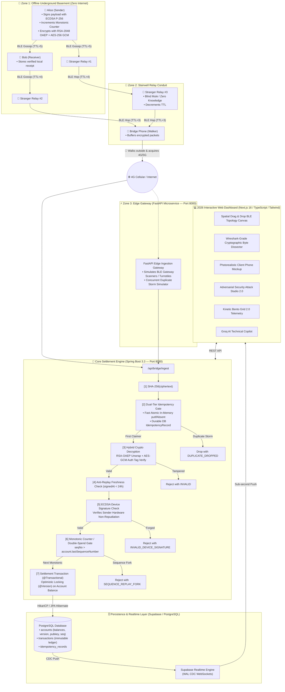

# 📡 UPI Offline Mesh — Decentralized Store-and-Forward Payment Network

[](https://github.com/pranshu-rajan/upi-offline-mesh/actions)
[](https://upi-offline-rho.vercel.app)
[](https://upi-offline-mesh-rrm4.onrender.com/api/server-key)
[](https://supabase.com)


> **Decentralized offline UPI payments routed through an opportunistic Bluetooth Low Energy (BLE) store-and-forward mesh network, featuring hardware-grade ECDSA non-repudiation, zero-knowledge hybrid cryptography, monotonic double-spending defense, and dual-tier atomic settlement.**

---

### 🌐 Live Production Deployments
* **Interactive Web Dashboard (Vercel)**: [https://upi-offline-rho.vercel.app](https://upi-offline-rho.vercel.app)
* **Settlement Engine REST Core (Render)**: [https://upi-offline-mesh-rrm4.onrender.com](https://upi-offline-mesh-rrm4.onrender.com/api/server-key)
* **Realtime Database**: [Supabase PostgreSQL & Realtime WebSockets](./supabase/README.md) (with automated zero-config H2 fallback for local development)

---

## 📑 Table of Contents
1. [The Real-World Problem & Existing Research](#-the-real-world-problem--existing-research)
2. [What This Project Solves & How (In Simple Terms)](#-what-this-project-solves--how-in-simple-terms)
3. [End-to-End System Architecture](#-end-to-end-system-architecture)
4. [Deep-Dive Cryptographic Protocol](#-deep-dive-cryptographic-protocol)
5. [Codebase Tour & Implementation Breakdown](#-codebase-tour--implementation-breakdown)
6. [Adversarial Security Attack Studio](#-adversarial-security-attack-studio)
7. [Local Quickstart & Docker Compose](#-local-quickstart--docker-compose)
8. [Automated Verification & Concurrency Tests](#-automated-verification--concurrency-tests)
9. [Production Deployment Guide (Vercel & Render)](#-production-deployment-guide-vercel--render)
10. [Honest Engineering Constraints & Future Roadmap](#-honest-engineering-constraints--future-roadmap)

---

## 🔬 The Real-World Problem & Existing Research

### The Problem: The "Connectivity Cliff" in Digital Payments
India's **Unified Payments Interface (UPI)** processes over 14 billion transactions monthly. However, traditional UPI operates on a strict **synchronous client-server architecture**: both the sender, receiver, and central bank must have active, low-latency internet connectivity at the instant of transaction.

When connectivity drops — in **underground basements, metro tunnels, flights, rural areas, disaster zones, or severe network congestion** — digital financial infrastructure collapses.

### Existing Research & Prior Art Comparison

| Payment Method / Prior Art | Transmission Medium | Internet Requirement | Vulnerability / Bottleneck |
|---|---|---|---|
| **Traditional UPI (GPay, PhonePe, Paytm)** | 4G/5G Cellular / Wi-Fi | **100% Online** for both parties | Instant transaction failure when cellular connectivity drops. |
| **NPCI UPI 123PAY (*99# USSD)** | GSM Telecom Voice/SMS | Requires cellular telecom signal | Fails in zero-signal basements, tunnels, flights, and disaster zones. |
| **Ultrasonic / Sound-Wave Pay (ToneTag)** | Acoustic audio pulses | Merchant POS must be online | High ambient noise failure rate; strictly point-to-point without multi-hop relay. |
| **Delay-Tolerant Networking (DTN / RFC 5050)** | Ad-hoc opportunistic hops | Deferred upload | Vulnerable to duplicate upload storms, rogue intermediary tampering, and offline double-spending without central coordination. |
| **UPI Offline Mesh (This Project)** | **Opportunistic BLE Gossip Mesh** | **0% Internet at transaction time** | **Solved**: Zero-knowledge hybrid cryptography, hardware ECDSA signatures, monotonic double-spending protection, and atomic dual-tier idempotency. |

---

## 💡 What This Project Solves & How (In Simple Terms)

### 1. The Zero-Connectivity Problem
* **The Challenge**: You are in an underground basement with no cell signal. You need to pay ₹500 to a friend. Neither of you has internet.
* **How It's Solved**: Your phone packages the payment into an encrypted packet and broadcasts it over Bluetooth Low Energy (BLE). The packet hops device-to-device through stranger phones (acting as "blind mules") via store-and-forward gossip. Eventually, when *any* stranger walks outside into 4G range, their phone silently and opportunistically uploads the packet to the central settlement bank.

### 2. The Untrusted Intermediary Problem
* **The Challenge**: A stranger's phone carries your financial payment. Can they read your balance, steal funds, or change the recipient?
* **How It's Solved**: **Zero-Knowledge Hybrid Encryption (RSA-2048 OAEP + AES-256-GCM)**. The packet is locked using the Central Bank's public key. To the stranger's phone, the packet is an opaque, unreadable blob of ciphertext. If a rogue node flips a single bit, the authenticated 128-bit Galois Authentication Tag fails at the bank, rejecting the packet instantly.

### 3. The Offline Double-Spending & Sequence Fork Problem
* **The Challenge**: Without an internet connection to verify your bank balance, what prevents Alice from paying ₹500 to Bob and simultaneously paying the same ₹500 to Carol while offline?
* **How It's Solved**: **Hardware-Backed Monotonic Sequence Counters & ECDSA Signatures**. Each device possesses an ECDSA P-256 keypair stored in hardware (Android StrongBox / Secure Enclave). Transactions carry a strictly monotonic counter ($seqNo = lastSeq + 1$). If Alice attempts an offline fork (signing two conflicting payments with the identical sequence number), the settlement engine settles the first and automatically rejects the second with `SEQUENCE_REPLAY_FORK`.

### 4. The Multi-Bridge Duplicate Storm
* **The Challenge**: Three pedestrians carry the same packet in their phone buffers. All three walk outside into the subway exit at the exact same millisecond and upload the packet simultaneously.
* **How It's Solved**: **Dual-Tier Atomic Idempotency**. The server computes `SHA-256(ciphertext)` *before* expensive decryption. An atomic in-memory compare-and-set (`putIfAbsent`, analogous to Redis `SETNX`) combined with a durable database audit ledger guarantees that exactly **one** thread succeeds and settles; concurrent deliveries are dropped as `DUPLICATE_DROPPED` with zero duplicate debits.

---

## 🏗 End-to-End System Architecture



---

## 🔐 Deep-Dive Cryptographic Protocol

Every offline transaction travels through a multi-layer cryptographic envelope before reaching the ledger:

```
┌─────────────────────────────────────────────────────────────────────────────┐
│                       OFFLINE MESH PACKET WIRE ANATOMY                      │
├─────────────────────────────────────────────────────────────────────────────┤
│ 1. [0x0000 - 0x0100] RSA-2048 OAEP Wrapped Session Key (256 Bytes)          │
│    • Recipient: Central Settlement Server Public Key (KID: 0x2048_SERVER)   │
│    • Padding: OAEP with SHA-256 digest & MGF1ParameterSpec.SHA256          │
├─────────────────────────────────────────────────────────────────────────────┤
│ 2. [0x0101 - 0x010C] AES-GCM Initialization Vector (12 Bytes / 96-bit IV)   │
│    • Cryptographically Secure Random IV (CSPRNG)                           │
├─────────────────────────────────────────────────────────────────────────────┤
│ 3. [0x010D - END] Authenticated Ciphertext Payload                          │
│    • Encrypted with AES-256 in Galois/Counter Mode (GCM)                    │
│    • 128-bit Authentication Tag: Ensures complete tamper detection          │
│                                                                             │
│    DECRYPTED JSON INSTRUCTION CONTAINS:                                     │
│    {                                                                        │
│      "senderVpa": "alice@demo",                                             │
│      "receiverVpa": "bob@demo",                                             │
│      "amount": 500.00,                                                      │
│      "pinHash": "e3b0c44298fc...",                                          │
│      "nonce": "3fa85f64-5717-4562-b3fc-2c963f66afa6",                      │
│      "signedAt": 1730380800000,                                             │
│      "sequenceNumber": 4,                                                   │
│      "deviceSignature": "MEYCIQC...",                                       │
│      "devicePublicKey": "MFkwEwYHKoZIzj0CAQY..."                            │
│    }                                                                        │
└─────────────────────────────────────────────────────────────────────────────┘
```

---

## 📂 Codebase Tour & Implementation Breakdown

```
UPI_Without_Internet/
├── src/main/java/com/demo/upimesh/
│   ├── config/AppConfig.java                  # Thread pools, CORS, and scheduled executors
│   ├── controller/ApiController.java          # REST endpoints for key exchange, simulator, and ingestion
│   ├── crypto/
│   │   ├── DeviceCryptoService.java           # Hardware ECDSA P-256 signature generator & validator
│   │   ├── HybridCryptoService.java           # RSA-2048 OAEP + AES-256-GCM encryption & SHA-256 hashing
│   │   └── ServerKeyHolder.java               # Persistent server keypair management across restarts
│   ├── model/
│   │   ├── Account.java                       # Bank account entity with @Version optimistic lock & seq counter
│   │   ├── IdempotencyRecord.java             # Durable audit ledger for deduplicating packet hashes
│   │   ├── MeshPacket.java                    # Wire packet envelope with TTL and ciphertext
│   │   ├── PaymentInstruction.java            # Decrypted payment payload with digital signature
│   │   └── Transaction.java                   # Immutable financial ledger entry
│   └── service/
│       ├── BridgeIngestionService.java        # Core pipeline: Hash -> Idempotency -> Decrypt -> Verify -> Settle
│       ├── DemoService.java                   # Seeds demo accounts with ECDSA keys & builds test packets
│       ├── IdempotencyService.java            # Dual-tier atomic cache (ConcurrentHashMap + DB persistence)
│       ├── MeshSimulatorService.java          # Spatial BLE gossip mesh with path loss & dynamic topology
│       ├── SettlementService.java             # ACID transactional ledger updates with anti-fork check
│       └── VirtualDevice.java                 # Simulated mobile device with (x,y) coordinates & battery
│
├── frontend/src/
│   ├── app/
│   │   ├── globals.css                        # Glassmorphism 3.0, specular highlights & cyber radar styles
│   │   ├── layout.tsx                         # Self-contained layout with offline font resilience
│   │   └── page.tsx                           # Master dashboard orchestrator (< 350 lines, modular)
│   ├── components/
│   │   ├── AttackStudio.tsx                   # Adversarial Security Attack Studio 2.0 (MITM, Fork, Replay)
│   │   ├── MeshAiChatbot.tsx                  # Groq AI Technical Assistant with Markdown tables
│   │   ├── MeshTopologyCanvas.tsx             # Spatial 2D drag-and-drop physics canvas with pulse conduits
│   │   ├── MobileDeviceMockup.tsx             # Photorealistic client smartphone with keypad & QR modal
│   │   ├── PacketByteDissector.tsx            # Wireshark-grade cryptographic wire inspector & bit-flipper
│   │   └── SoundEffects.ts                    # Native Web Audio synthesizer for tactile haptic feedback
│   ├── lib/supabaseClient.ts                  # Supabase client with auto-sanitizing URLs & Realtime
│   └── types/mesh.ts                          # Strict TypeScript domain interfaces
│
├── gateway/main.py                            # FastAPI edge bridge microservice (Port 8000)
├── supabase/schema.sql                        # Production PostgreSQL schema, indexes, and Realtime rules
├── docker-compose.yml                         # 1-click full-stack container orchestration
├── Dockerfile.backend                         # Multi-stage Eclipse Temurin 17 container
└── pom.xml                                    # Maven dependencies (Spring Boot 3.3.5, Hibernate, PostgreSQL)
```

---

## 🎯 Adversarial Security Attack Studio

The web dashboard features an interactive **Security Attack Studio 2.0** allowing developers to stress-test cryptographic and concurrency guarantees:

```
┌──────────────────────────────────────┬──────────────────────────────────┬─────────────────────────────┐
│ Attack Vector                        │ Adversarial Action               │ How the Engine Neutralizes  │
├──────────────────────────────────────┼──────────────────────────────────┼─────────────────────────────┤
│ 1. Man-in-the-Middle Bit-Flip        │ Rogue relay corrupts byte in     │ Rejected as INVALID due to  │
│                                      │ ciphertext to alter amount.      │ AES-GCM auth tag mismatch.  │
├──────────────────────────────────────┼──────────────────────────────────┼─────────────────────────────┤
│ 2. Offline Double-Spend Fork         │ Alice signs two conflicting      │ Monotonic counter check:    │
│                                      │ payments with the same seqNo.    │ 1st settles; 2nd rejected.  │
├──────────────────────────────────────┼──────────────────────────────────┼─────────────────────────────┤
│ 3. Forged Device Signature           │ Rogue node crafts instruction    │ ECDSA P-256 verification    │
│                                      │ without sender's private key.    │ fails against account key.  │
├──────────────────────────────────────┼──────────────────────────────────┼─────────────────────────────┤
│ 4. 5-Bridge Concurrent Duplicate Storm│ 5 bridges upload same packet at  │ Atomic putIfAbsent claims   │
│                                      │ the exact same millisecond.      │ hash; 4 duplicates dropped. │
└──────────────────────────────────────┴──────────────────────────────────┴─────────────────────────────┘
```

---

## 🚀 Local Quickstart & Docker Compose

### Option A: 1-Click Full-Stack Docker Compose (Recommended)

Run the entire ecosystem (Spring Boot core, Next.js frontend, and FastAPI gateway) with one command:

```bash
docker compose up --build
```

* **Interactive Web Dashboard**: [http://localhost:3000](http://localhost:3000)
* **Spring Boot Core API**: [http://localhost:8080](http://localhost:8080)
* **FastAPI Edge Gateway (Swagger UI)**: [http://localhost:8000/docs](http://localhost:8000/docs)
* **Embedded H2 Database Console**: [http://localhost:8080/h2-console](http://localhost:8080/h2-console) (`jdbc:h2:mem:upimesh`, User: `sa`, no password)

---

### Option B: Run Locally Without Docker

#### 1. Start the Core Settlement Backend (Java 17+)
```bash
# Windows
.\mvnw.cmd spring-boot:run

# Linux / macOS
./mvnw spring-boot:run
```
Settlement engine starts on `http://localhost:8080`.

#### 2. Start the Modern Next.js Frontend (Node 18+)
```bash
cd frontend
npm install
npm run dev
```
Dashboard starts on `http://localhost:3000`.

#### 3. Start the FastAPI Edge Bridge (Optional, Python 3.10+)
```bash
cd gateway
pip install -r requirements.txt
python main.py
```
Edge collector runs on `http://localhost:8000`.

---

## 🧪 Automated Verification & Concurrency Tests

Run the comprehensive concurrency and cryptographic verification test suite:

```bash
# Windows
.\mvnw.cmd test

# Linux / macOS
./mvnw test
```

### Automated Assertions Tested:
1. **`singlePacketDeliveredByThreeBridgesSettlesExactlyOnce`**: 3 concurrent threads simulate 3 bridge phones delivering the identical packet simultaneously. Asserts exactly 1 `SETTLED`, exactly 2 `DUPLICATE_DROPPED`, and balance debited exactly once.
2. **`tamperedCiphertextIsRejected`**: Flips a single bit in the AES-GCM ciphertext and asserts that `BridgeIngestionService` rejects it with `INVALID`.
3. **`offlineDoubleSpendSequenceForkIsRejected`**: Signs two conflicting payments with the identical monotonic sequence number. Asserts the second attempt is rejected by the ledger.
4. **`forgedDeviceSignatureIsRejected`**: Injects an invalid ECDSA P-256 signature and asserts that the engine rejects the transaction.
5. **`encryptDecryptRoundTrip`**: Validates the full RSA-2048 OAEP + AES-256-GCM hybrid encryption roundtrip.

---

## ☁️ Production Deployment Guide (Vercel & Render)

### 1. Deploying Frontend to Vercel
1. Push this repository to your GitHub account.
2. Import the project in [Vercel](https://vercel.com) and set the **Root Directory** to `frontend`.
3. Configure the following Environment Variables in Vercel:
   * `NEXT_PUBLIC_API_URL`: `https://upi-offline-mesh-rrm4.onrender.com/api` (or your Render URL)
   * `NEXT_PUBLIC_SUPABASE_URL`: `https://<your-project-ref>.supabase.co`
   * `NEXT_PUBLIC_SUPABASE_ANON_KEY`: `<your-supabase-anon-key>`
   * `GROQ_API_KEY`: *(Optional)* For the live AI Technical Assistant
4. Deploy!

### 2. Deploying Backend to Render
1. In [Render](https://render.com), create a new **Web Service** connected to your repository.
2. Set Runtime to **Docker** and point to `Dockerfile.backend`.
3. Configure Environment Variables in Render:
   * `SERVER_PORT`: `8080`
   * `SPRING_DATASOURCE_URL`: `jdbc:postgresql://db.<your-project-ref>.supabase.co:5432/postgres?sslmode=require`
   * `SPRING_DATASOURCE_USERNAME`: `postgres`
   * `SPRING_DATASOURCE_PASSWORD`: `<your-supabase-password>`
   * `SPRING_JPA_HIBERNATE_DDL_AUTO`: `update`
4. Expose port `8080`.
*(Note: If no database credentials are supplied, the backend seamlessly falls back to H2 in-memory mode.)*

---

## ⚖️ Honest Engineering Constraints & Future Roadmap

This codebase is a high-assurance demonstration of **mesh-routed deferred settlement**. In real-world commercial production, the following constraints apply:

1. **Deferred Settlement vs Instant Merchant Delivery**: In pure store-and-forward, the merchant does not receive confirmation until a bridge reaches 4G. To mitigate merchant risk, the protocol supports **Offline Pre-Authorized Balance Proofs** (similar to UPI Lite Offline or CBDC smart cards), restricting maximum offline transfers to pre-funded limits (default ₹5,000.00).
2. **OS Bluetooth Throttling**: Modern iOS and Android operating systems restrict background BLE advertising and scanning to conserve battery. In a commercial mobile deployment, this requires native foreground services or integration with Google Nearby Connections API.
3. **Hardware Keystore Integration**: In this full-stack simulator, client ECDSA keypairs are simulated in memory; in a native mobile application, they bind directly to the Android KeyStore (`KeyProperties.PURPOSE_SIGN`) with biometric authentication.

---

## 📄 License

This project is open-source software licensed under the [MIT License](LICENSE).
